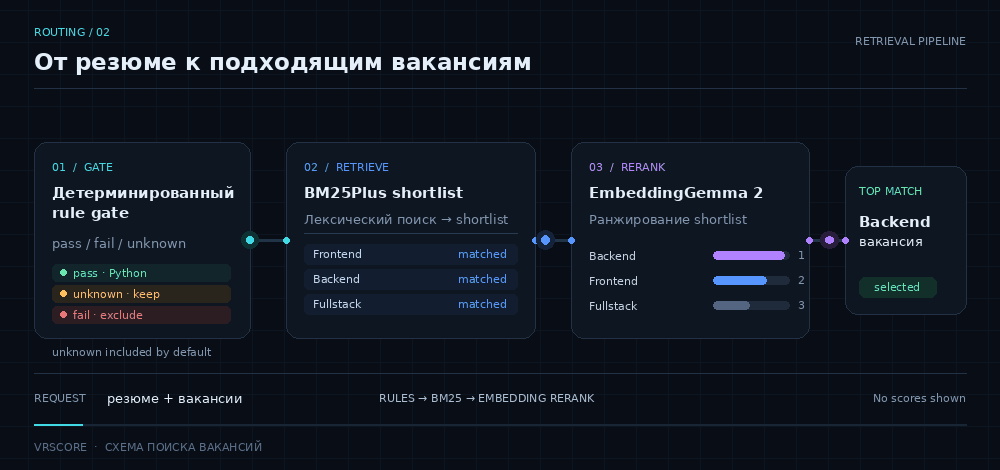

<div align="center">


### Резюме и вакансии — с аргументами, а не только с оценкой

[Демо](https://vrscore.demo.87.120.84.200.sslip.io/), токен: `токен`

Сопоставление документов · поиск вакансий · разбор требований по источникам

[](https://www.python.org/) [](https://hydra.cc/) [](#как-это-работает) [](https://huggingface.co/google/embeddinggemma-2) [](#модель-и-стек)

[Как это работает](#как-это-работает) &nbsp;·&nbsp; [Модель и стек](#модель-и-стек) &nbsp;·&nbsp; [Бенчмарк](#бенчмарк) &nbsp;·&nbsp; [Запуск](#запуск-и-конфигурация) &nbsp;·&nbsp; [Данные](#данные)

</div>

---

## Зачем это нужно

VRScore сопоставляет резюме с набором вакансий: извлекает факты из документов, последовательно сужает список и помогает рекрутеру разобраться в требованиях и подтверждениях.

## Как это работает



<table>
<tr>
<td width="25%"><b>01 · Факты</b><br><br>Извлечение сведений и проверка цитат по тексту документов.</td>
<td width="25%"><b>02 · Фильтр</b><br><br>Проверка условий вакансии с учётом неизвестных значений.</td>
<td width="25%"><b>03 · BM25</b><br><br>Лексический поиск по навыкам и отбор короткого списка.</td>
<td width="25%"><b>04 · Эмбеддинги</b><br><br>Семантическое переупорядочивание отобранных вакансий.</td>
</tr>
</table>

Для каждой вакансии разбор показывает статусы требований, фрагменты документов, сильные стороны, пробелы и вопросы кандидату. Оценки поиска не следует интерпретировать как вероятность успешного найма.

<details>
<summary><b>Что важно знать об ограничениях</b></summary>
<br>

- Лексический поиск чувствителен к перечисленным навыкам: их обилие в резюме может помочь пройти фильтрацию, даже если реальный опыт не подтверждён.
- Семантическое ранжирование применяется к shortlist после BM25: вакансии, не попавшие в него, на этом этапе не переоцениваются.
- Извлечение и сравнение могут ошибаться; цитаты и выводы необходимо проверять по исходным документам.

</details>

## Модель и стек

<a href="https://ai.google.dev/gemma/docs/embeddinggemma"></a>

**EmbeddingGemma 2** используется для семантического ранжирования shortlist. По умолчанию настроены `google/embeddinggemma-2`, CPU, PyTorch и размерность вектора 128; backend также поддерживает ONNX и OpenVINO при наличии соответствующих зависимостей. Параметры можно изменить через Hydra.

<table>
<tr>
<td> &nbsp;<b>Python 3.12+</b><br>основной язык</td>
<td> &nbsp;<b>ONNX Runtime</b><br>поддерживаемый backend инференса</td>
<td> &nbsp;<b>Milvus</b><br>векторы и кэш эмбеддингов</td>
<td> &nbsp;<b>Hugging Face</b><br>модель и transformers</td>
</tr>
</table>

Также используются **Hydra** для конфигурации, **BM25** для лексического поиска, **Milvus** для хранения векторов и опционального постоянного кэша эмбеддингов документов, **OpenRouter** для LLM-запросов. Кэш retrieval pipeline по умолчанию отключён; для его включения через `document_cache_collection` нужен совместимый fingerprint энкодера. Встроенный энкодер формирует его для PyTorch с закреплённой ревизией модели, но не для ONNX.

## Бенчмарк

Среднее по 10 последовательным запросам каждого типа на небольшой выборке с повторами; модель эмбеддингов заранее загружена на CPU.

| | Вакансия | Резюме |
|:--|--:|--:|
| Индексация без LLM | 1,987 с | 2,496 с |
| Индексация с LLM | **9,512 с** | **12,189 с** |
| Стоимость LLM на документ | $0,001364 | $0,001442 |

Это экспериментальные замеры, а не оценка production-нагрузки. Время зависит в том числе от внешнего LLM-сервиса и сети. [Методика, условия и воспроизведение →](public_docs/indexing-benchmark.md)

## Запуск и конфигурация

**Требования:** Python 3.12+, `uv`, доступ к весам модели и настроенные сервисы для выбранного сценария.

```bash
uv sync --locked --extra embeddings
```

Точки входа из корня проекта:

```bash
uv run python -m vrscore.embedding_server
uv run python -m vrscore.demo
```

### Docker Compose

На Linux установите Docker с Compose и подготовьте файлы Milvus `.data/milvus/minio.env` и `.data/milvus/user.yaml`. Затем заполните токен демо (не менее 24 символов), ключ OpenRouter и при необходимости `HF_TOKEN` в файле `.env.docker`:

```bash
cp .env.example .env.docker
docker compose --env-file .env.docker up -d --build
```

Демо доступно на `http://127.0.0.1:18765`. Модель и кэш сохраняются в Docker volumes; дополнительные вакансии по умолчанию отключены. Данные `public_data/` монтируются только для чтения и не входят в образы.

<details>
<summary><b>Бенчмарк индексации: дополнительные условия</b></summary>
<br>

Для воспроизведения требуется настроенный Milvus, доступ к весам модели и `OPENROUTER_API_KEY`. Запуск отправляет платные запросы; см. [подробные инструкции](public_docs/indexing-benchmark.md).

</details>

## Данные

- `public_data/raw/` и `public_data/parsed/` — исходные документы и обработанные представления.
- `public_data/mfti_matching_gt/` — 10 резюме, 20 вакансий и 200 пар. Разметка выполнена ИИ и не проверена человеком; статусы требований размечены частично. Набор содержит обработанные реальные резюме, полная анонимность не гарантирована: он предназначен для приватного репозитория. Подробности — в [манифесте](public_data/mfti_matching_gt/manifest.json).

## Структура проекта

| Путь | Назначение |
|:--|:--|
| `vrscore/` | Сопоставление, индексы, демонстрация и эксперименты |
| `configs/` | Конфигурации Hydra |
| `public_data/` | Документы и обработанные наборы данных |
| `public_docs/` | Документация экспериментов |
| `tests/` | Тесты проекта |
